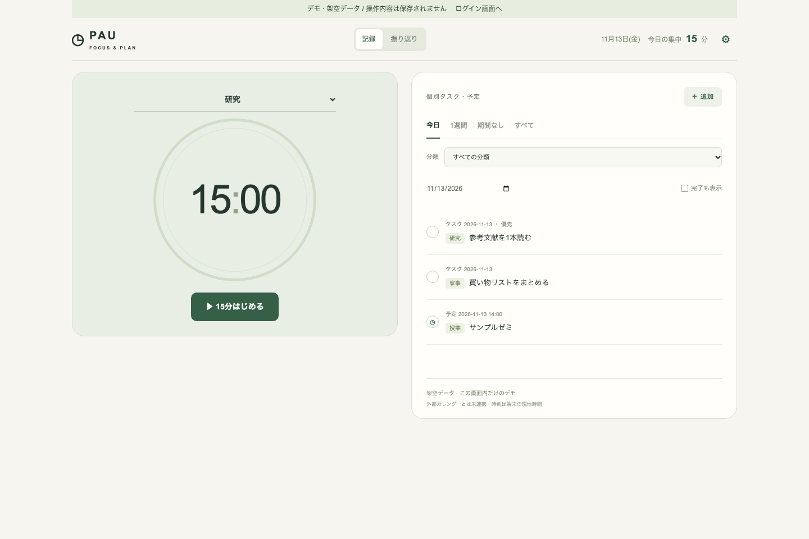
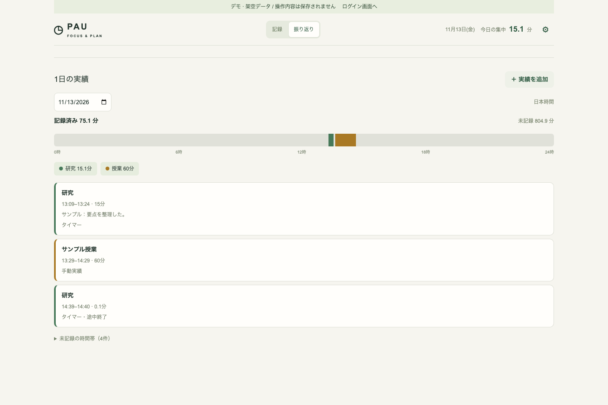
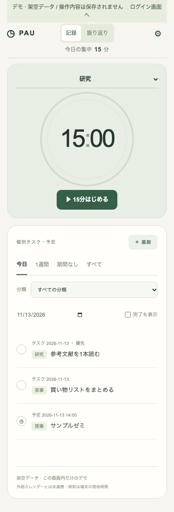

# 15min — FOCUS & PLAN

15分タイマー、予定・タスク、活動実績と日別の振り返りをひとつにまとめたアプリです。React / TypeScript / Vinext / Cloudflare Workers / D1 で動作します。Google認証でユーザーごとに記録を分離します。



## できること

- 活動を分類して15分計測。研究・家事など、用途に合わせて分類を追加できます。
- 一時停止・再開。停止中の「終了」で実働分を保存。開始前にはリセットを表示しません。
- 終了時刻とサーバー側revisionを使った約4秒間隔の端末間同期。
- 予定・タスクの追加、編集、完了、削除。日付・分類別の表示。
- 活動実績の手動記録。開始・終了、日跨ぎ、任意メモ、実績の消去。
- 日別時間軸、分類色、未記録時間、重複控除。振り返りは日本時間、予定入力は端末の現地時間です。

画面を閉じた状態での通知は保証しません。

## 画面

以下はローカルの本番ビルドをブラウザーで表示して撮影した実画面です。すべて架空データです。





## ローカルで試す

Node.js 22.18以上（検証は25.9.0）とnpmが必要です。

```sh
npm ci
npm run db:migrate:local
npm run build
npm start -- --port 8787
```

`http://127.0.0.1:8787/demo` を開くと、認証情報なしで架空データのデモを操作できます。デモはブラウザーのメモリー内だけで動き、API・D1を利用しません。再読込するとリセットされます。

**Google認証を設定しない限り `/` と `/api/*` は503で拒否します。** デモが見えることは本番データへのアクセス許可を意味しません。

開発サーバーは `npm run dev`（既定5173）。Googleログインを試す場合は `.dev.vars.example` を `.dev.vars` にコピーし、利用するローカルURLとGoogle OAuthの値を設定してください。`.dev.vars` はコミット禁止です。

## Google認証と運用

[セットアップ手順](docs/setup.md)を参照してください。Google Cloud登録、認証情報発行、Cloudflare資源作成、デプロイはこのリポジトリの公開とは別の手順です。既存の個人用アプリや記録を自動的に移行・変更しません。

| 設定 | 用途 |
|---|---|
| `APP_ORIGIN` | 正規のorigin。末尾スラッシュなし。本番はHTTPS必須 |
| `APP_ENV` | ローカルHTTPを使う場合のみ `development` |
| `GOOGLE_CLIENT_ID` | OAuth Web client ID |
| `GOOGLE_CLIENT_SECRET` | サーバー専用の秘密値 |
| `AUTH_ALLOWED_EMAILS` | 任意。カンマ区切りの利用許可メール。空欄なら検証済みGoogleユーザーが各自の領域を利用可能 |
| `DB` | D1 binding |

[システム構成図](docs/architecture.md) / [セキュリティ設計](SECURITY.md) / [検証方法と結果](docs/testing.md)

## 検証コマンド

```sh
npm run typecheck
npm test
npm run lint
npm run build
npm audit
```

ブラウザーテストと実Worker/D1の統合テストは [docs/testing.md](docs/testing.md) を参照してください。

## ライセンス

プロジェクトのライセンスは未決です。公開したことをもってMIT等の広い利用許諾を付与するものではありません。ライセンス確定までは再利用・再配布の条件をリポジトリ所有者に確認してください。依存パッケージには各パッケージのライセンスが適用されます。
