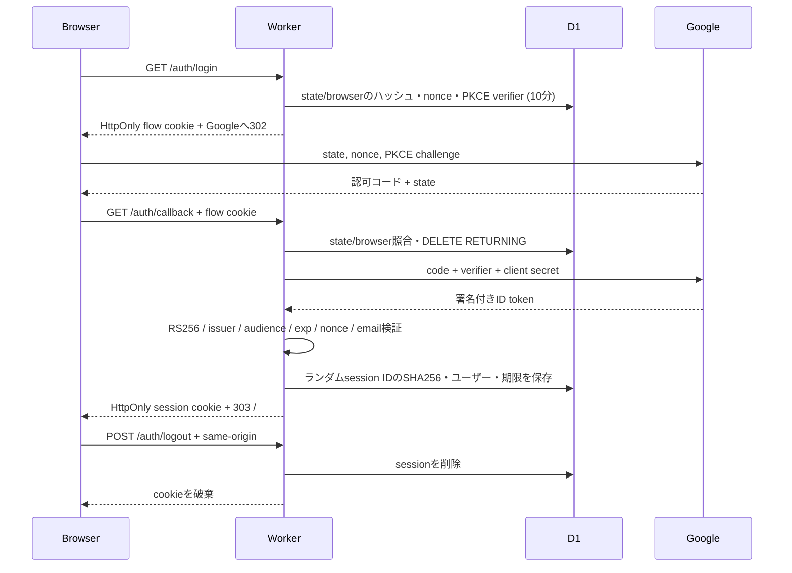

# システム構成

```mermaid
flowchart LR
  U[PC / スマートフォン] -->|HTTPS / HttpOnly cookie| W[Cloudflare Worker\nVinext / React]
  W -->|認証開始: state + nonce + PKCE| G[Google OpenID Connect]
  G -->|認可コード| W
  W -->|サーバー間交換 / JWKS署名検証| G
  W --> A[認証・Origin・入力検証]
  A --> P[予定 / タスク / 手動実績 API]
  A --> T[タイマー状態遷移 API]
  P --> D[(D1)]
  T -->|revision比較 / 原子的batch| D
  D --- R[planner_items\nowner = google:sub]
  D --- S[auth_sessions\nハッシュ化session ID / 7日有効]
  D --- O[oauth_flows\n10分 / 一度だけ消費]
  U --> M[/demo\n架空データ / ブラウザーメモリー]
```

## タイマーとデータ

`lib/tracking.ts` に既存の状態遷移・区間集計を保持しています。サーバー時刻で終了時刻と実働区間を確定し、画面はAPIが返すサーバー時刻と `performance.now()` の経過時間を使って残り時間を表示します。端末の壁時計がずれても早く終了通知を出しません。約4秒の再取得で古いrevisionに戻らないようにしています。同じrevisionの競合操作は一方のみを反映し、他方は409になります。409の直後は状態を再取得し、サーバーがcompletedを返した場合だけ終了を通知します。終了処理の失敗は表示更新・4秒同期で共通のゲートを通し、4秒から最大60秒まで指数バックオフします。

D1の `planner_items` はユーザーIDを含む主キーとownerを持ちます。読取・書込は認証済みユーザーに限定されます。タイマーの内部状態は汎用items APIから変更できません。タイマー由来実績の開始・終了はサーバーだけが管理し、UIからはメモと消去フラグのみ変更できます。

日別振り返りは区間を日本時間の日付境界で切り分けます。全体の記録済み時間は区間の和集合で重複を控除します。分類別の合計は分類内で重複を控除するため、複数分類の重なりがあると分類合計と全体合計は一致しない場合があります。未来の時間は未記録時間に含めません。

## 独立した公開版

公開版はGoogleの `sub` を所有者キーにします。元の認証IDをGoogleアカウントへ自動対応させません。既存アプリの認証、保存先、記録、公開設定は変更しません。元の運用設定、接続資格情報、DB、Git履歴をこのリポジトリへ持ち込みません。

## 認証フロー


